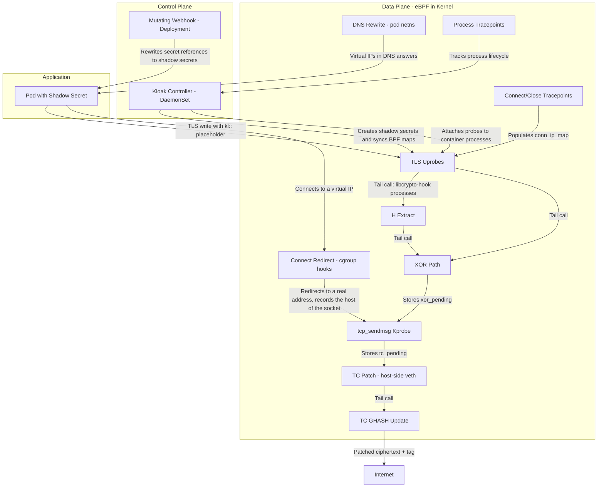
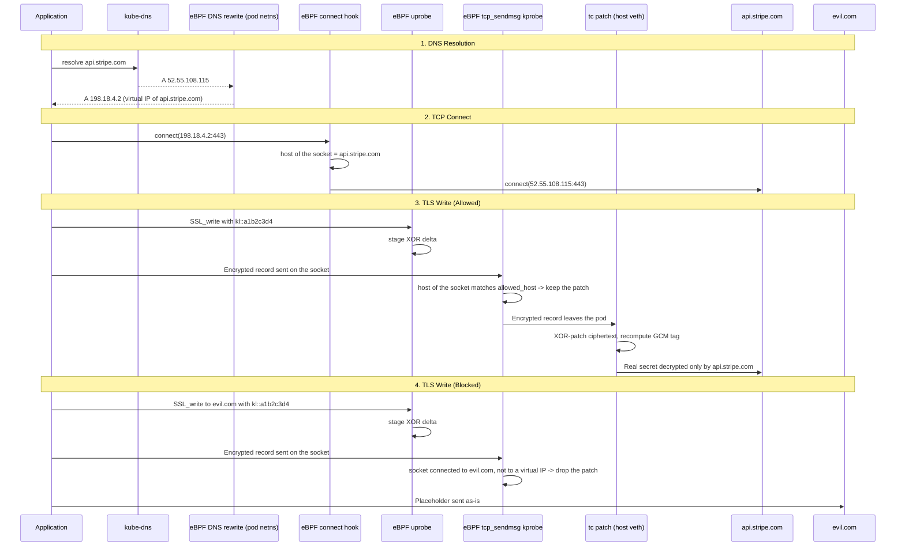

<div align="center">
  <a href="https://getkloak.io/"></a>
</div>

<h1 align="center"><a href="https://getkloak.io/">Kloak</a></h1>

<p align="center">
  <b>Secure Your Secrets, Agentless</b><br>
  Kubernetes eBPF HTTPS interceptor. Transparent secret injection without application changes or sidecars.
</p>

<div align="center">

[](https://github.com/spinningfactory/kloak/actions/workflows/ci.yml)
[](https://gist.github.com/dhiaayachi/2d4be46e60ee478d5703d8b009dbd6e9)
[](https://go.dev/)
[](https://kubernetes.io/)
[](LICENSE)

</div>

---

Kloak transparently intercepts outbound TLS traffic in Kubernetes using eBPF uprobes, replacing placeholders with real secrets in-kernel by patching the encrypted TLS record on its way out of the pod. Applications never handle actual credentials, and no sidecars or code changes are required.

## Features

- **No code changes** -- No SDK, no library, no application modifications. Mount a secret, make HTTPS requests, and Kloak handles the rest.
- **Secret isolation** -- Applications only see random shadow values (`kl::…`, same length as the real value). The real value is never written into the pod's memory; it is XOR-patched into the AES-GCM ciphertext in-kernel.
- **Zero overhead** -- eBPF uprobes operate in kernel space with negligible latency impact. No userspace proxy or sidecar in the data path.
- **Kubernetes native** -- Works with standard Kubernetes Secrets. Enable with a single label.
- **Per-pod secret binding** -- A pod can only use the secrets it references in its spec (Secret volume, `secretKeyRef`, `envFrom`). A placeholder sent by any other pod, even one that learned it, goes out unchanged.
- **Host and IP filtering** -- Secrets annotated with `getkloak.io/hosts` are only sent to specific destination hostnames or IP addresses, preventing exfiltration to unauthorized servers. Each restricted hostname gets its own virtual IP, so kloak knows which host a connection is for even when hosts share addresses (a CDN, a shared ingress).
- **Port-based filtering** -- Secrets annotated with `getkloak.io/port` are restricted to connections on a specific destination port.
- **Broad runtime support** -- Hooks into OpenSSL, BoringSSL, and Go's native `crypto/tls`. Works with Python, Node.js, Bun, Go, Rust, Ruby, PHP, curl, and any OpenSSL-linked runtime.

## Quick Start

### Prerequisites

- Kubernetes cluster (1.28+) with Linux kernel 5.17+ (6.6+ attaches the tc patch program via TCX; older kernels fall back to a clsact qdisc + cls_bpf filter, see `controller.ebpf.tcAttachMode`)
- The virtual IP ranges kloak hands out (default `198.18.0.0/15` and `2001:2::/48`, reserved for benchmarking and never routed) must not be used by the cluster or its nodes. The controller checks this at startup and refuses to start otherwise (`controller.ebpf.virtualIPRange`).
- containerd 2.0+ or CRI-O 1.30+ is recommended: through their NRI hook, kloak sets up a pod's DNS rewrite before its containers start. On other runtimes it is set up as soon as the pod's sandbox runs, which leaves a short window at pod start (see `controller.nri` in the chart values).
- [Helm](https://helm.sh/docs/intro/install/) 3.12+
- `kubectl` configured with cluster access

### Install with Helm

```bash
helm repo add kloak https://chart.getkloak.io
helm repo update

helm install kloak kloak/kloak -n kloak-system --create-namespace

kubectl get pods -n kloak-system
```

### Upgrading from v0.2.x and earlier

Host-restricted secrets now use virtual IPs (see [Host Verification](#host-verification)) instead of reading the DNS answers pods receive:

- Restart kloak-enabled pods after the upgrade. Pods that were already running keep the addresses they resolved, and a connection to a real address gets no host-restricted secret.
- If the controller refuses to start because a virtual IP range overlaps an address range of the cluster or a node, set `controller.ebpf.virtualIPRange` to free ranges.

### Labels and Annotations

| Key | Type | Scope | Description |
|-----|------|-------|-------------|
| `getkloak.io/enabled=true` | Label | Secret, Namespace, Pod | Enables Kloak for the target resource. On namespaces and pods, controls webhook scope. On secrets, triggers shadow secret creation. |
| `getkloak.io/hosts=host` | Annotation | Secret | Restricts which destination host or IP address a secret can be sent to (single value only) |
| `getkloak.io/port=443` | Annotation | Secret | Restricts which destination port a secret can be sent to |
| `getkloak.io/managed=true` | Label | Secret | Marks shadow secrets created by Kloak (do not set manually) |

### Try the Demo

```bash
# Full demo: creates a Lima VM with K3s, deploys Kloak and sample apps
./examples/setup-demo.sh

export KUBECONFIG=/tmp/kloak-k3s.yaml

# View logs (should show real secrets in httpbin.org responses)
kubectl logs -f -l app=demo-python -n kloak-demo -c demo-app

# Cleanup
./examples/destroy-demo.sh
```

## Architecture

Kloak consists of a control plane (controller + webhook) and an eBPF data plane that runs entirely in kernel space.



### Components

| Component | Description |
|-----------|-------------|
| **Controller** (DaemonSet) | Watches Secrets labeled `getkloak.io/enabled=true`, creates shadow secrets with random `kl::…` placeholders of the same length as each real value, syncs real values into eBPF maps, and attaches TLS uprobes to container processes via cgroup discovery. |
| **Webhook** (Deployment) | Mutating admission webhook that intercepts Pod creation. Rewrites Secret volume mounts and environment variable references (`secretKeyRef`, `envFrom`) to point to shadow secrets. Evaluates enablement through pod labels or namespace labels. Rejects pods if the shadow secret has not been created yet (fail-closed). Two webhook entries ensure only kloak-enabled namespaces and pods are affected; non-kloak workloads are never impacted, even when the webhook is down. |
| **TLS Uprobes** | Attach to `SSL_write` / `SSL_write_ex` (OpenSSL/BoringSSL), `crypto/tls.(*Conn).Write` (Go native), and `SSL_write` at a pre-computed file offset in symbol-stripped Bun binaries. Intercept outbound TLS writes and scan the plaintext for `kl::` placeholders. The plaintext buffer is only read, never modified. |
| **H Extract** | Recovers the connection's AES-GCM GHASH key `H`, which is needed to fix the authentication tag after patching. For processes whose `libcrypto` exposes `EVP_CipherInit_ex`, a uprobe captures it at cipher init. Otherwise the `tcp_sendmsg` kprobe walks the library's TLS structs to it. BoringSSL keeps only the AES key schedule, so `H = AES_K(0)` is recomputed in-kernel. |
| **XOR Path + TC Patch** | Used for every runtime. Computes `shadow XOR real` for each matched placeholder the pod may use. The `tcp_sendmsg` kprobe keeps only the patches whose host/IP/port policy matches the socket the record leaves on, and bridges them to a tc program on the host side of the pod's veth pair, which XOR-patches the AES-GCM ciphertext in the outgoing packet and recomputes the GHASH tag via a tail call to `tc_ghash_update`. The real secret is never written to user-space memory, and patching outside the pod's network namespace keeps the patched ciphertext out of reach of in-pod packet capture. |
| **DNS Rewrite** | A tc program inside the pod's network namespace. For a pod that references a secret restricted to a hostname, it replaces that host's A and AAAA records in answers from a trusted resolver with the host's virtual IPs, and records the real addresses. Other pods get the real answers. The controller attaches it while the container runtime creates the pod's sandbox (NRI), before its containers start. |
| **Connect Redirect** | `cgroup/connect4` and `connect6` programs on the pods' cgroups. A connect to a virtual IP goes to one of the host's real addresses, and the socket records the host it is for; `getpeername` still reports the virtual IP. A connect to a virtual IP with no known address is refused. |
| **Connect/Close Tracepoints** | Hooks `sys_enter/exit_connect` to track the TCP connections a process makes (fd to destination IP in `conn_ip_map`), which tells them apart from the connections it accepts. Hooks `sys_enter_close` to clean up stale entries. |
| **Process Tracepoints** | Hooks `sched_process_exec` and `sched_process_exit` to track container process lifecycle for uprobe attachment and cleanup. |

### Supported Runtimes

| Runtime | TLS Library | Hook Point |
|---------|------------|------------|
| Python, Rust, Ruby, PHP, curl | OpenSSL (libssl.so) | `SSL_write` / `SSL_write_ex` uprobe |
| Node.js | OpenSSL (statically linked into `node`) | `SSL_write` uprobe on the main executable |
| Apps linked against BoringSSL | BoringSSL (libssl.so) | `SSL_write` uprobe |
| Bun (incl. single-executable apps) | BoringSSL (statically linked, symbols stripped) | `SSL_write` uprobe at a per-version file offset (`tools/bun-offsets/`) |
| Go | crypto/tls (native) | `crypto/tls.(*Conn).Write` uprobe |

Secrets are patched into **AES-128-GCM and AES-256-GCM** records (TLS 1.2 and 1.3). Other ciphers (e.g. ChaCha20-Poly1305) and some libraries (GnuTLS, Go built with `GOEXPERIMENT=boringcrypto`) are not supported yet.

## Host Verification

Secrets with `getkloak.io/hosts` annotations are only rewritten on a connection to that host. This prevents secret exfiltration to unauthorized servers, even if an application is compromised.



### How Host Verification Works

1. **Virtual IPs** -- The controller gives every hostname in a `getkloak.io/hosts` annotation a stable virtual IP from `controller.ebpf.virtualIPRange` (an IPv4 and an IPv6 range). They are kept in BPF maps pinned on the node, so a controller restart keeps them.

2. **DNS rewrite** -- In the network namespace of each pod that references a secret restricted to the host, a tc program replaces the host's A and AAAA records in answers from a trusted resolver (kube-dns, or `controller.dns.trustedServers`) with its virtual IPs, and records the real addresses. Other pods get the real answers. With NRI (containerd 2.0+, CRI-O 1.30+), the container runtime waits for kloak to set this up before it starts the pod's containers.

3. **Connect redirect** -- A connect to a virtual IP goes to one of the host's real addresses, and the socket records the host it is for. A connect to a virtual IP whose host has no known address fails. The application still sees the virtual IP as its peer.

4. **Secret filtering** -- When the encrypted record is sent, the `tcp_sendmsg` kprobe compares the host of the socket (and the address and port it connected to, for a secret restricted to an IP or a port) with the secret's policy. Match: the patch goes on to the tc program. Mismatch: the patch is dropped and the placeholder is sent as-is, keeping the secret safe. A connection that did not go through a virtual IP (a hardcoded address, DNS over HTTPS) gets no host-restricted secret.

5. **SNI check** -- The socket's host is not enough on its own: CDNs and cloud load balancers serve many customers on the same IPs and route each TLS connection by its SNI, so a compromised app could connect to the virtual IP of `api.stripe.com` while naming another tenant's domain in its ClientHello. A kprobe on `tcp_sendmsg` records the SNI of each connection's first ClientHello, and a secret restricted to a hostname is only rewritten on a connection whose SNI is that host. The comparison is exact and case-insensitive: a client that connects to a short in-cluster name (`my-svc`) does not match an annotation with the full name (`my-svc.ns.svc.cluster.local`), so use the same name in both. Connections without SNI, with an encrypted ClientHello (ECH), or whose ClientHello could not be read are refused. Refusals are logged by the controller as an `SNI check violation`. Set `controller.ebpf.sniCheck: audit` to let them through while logging each one. Secrets restricted to an IP address, or to `*`, are not SNI-checked.

## How It Works

### 1. Label and Annotate Your Secrets

Add `getkloak.io/enabled=true` as a label to enable Kloak. Use annotations for host and port filtering. Kloak generates a shadow secret whose values are random `kl::…` placeholders of exactly the same length as the originals.

```yaml
apiVersion: v1
kind: Secret
metadata:
  name: api-credentials
  labels:
    getkloak.io/enabled: "true"
  annotations:
    getkloak.io/hosts: "api.stripe.com"
    getkloak.io/port: "443"
data:
  api-key: c2stbGl2ZS14eXoxMjM=  # sk-live-xyz123
```

### 2. Deploy Your Application

The webhook automatically rewrites the pod's secret references (volume mounts, `secretKeyRef`, `envFrom`) to use the shadow secret. Your application sees only `kl::…` placeholders and never handles real credentials.

```
# What the application reads from the mounted secret (same length as the real value):
kl::q7XmB2rTa9
```

Only the pods that reference a secret this way can use it. The controller binds each pod's containers to the secrets in its spec, and the data plane refuses to rewrite a placeholder for any other pod: the placeholder goes out unchanged and the controller logs a `secret binding violation`. Apps that read a shadow secret through the Kubernetes API instead of mounting it are refused too. Set `controller.ebpf.secretBinding: audit` to let such rewrites through while logging each one, to find these workloads before enforcing.

### 3. Automatic In-Kernel Rewrite

When the application makes an outbound HTTPS request, the eBPF uprobe reads the TLS write and stages a patch, which is kept only if the connection is to an allowed destination (see [Host Verification](#host-verification)). After the TLS library encrypts the record, a tc program on the host side of the pod's veth XOR-patches the ciphertext so that it decrypts to the real secret, and recomputes the AES-GCM tag. The real value never exists in the pod's memory.

```
# What the application writes (and what is in its memory):
Authorization: Bearer kl::q7XmB2rTa9

# What api.stripe.com decrypts (after the in-kernel ciphertext patch):
Authorization: Bearer sk-live-xyz123
```

## Development

```bash
make build          # Build the kloak binary
make test           # Run all tests
make docker-build   # Build Docker image
```

eBPF development requires Linux. On macOS, Kloak uses Lima VMs:

```bash
make lima-start      # Start Lima VM
make generate-ebpf   # Generate eBPF Go bindings
make test-linux      # Run tests in Linux VM
make lima-shell      # Shell into VM
```

## License

AGPL-3.0
